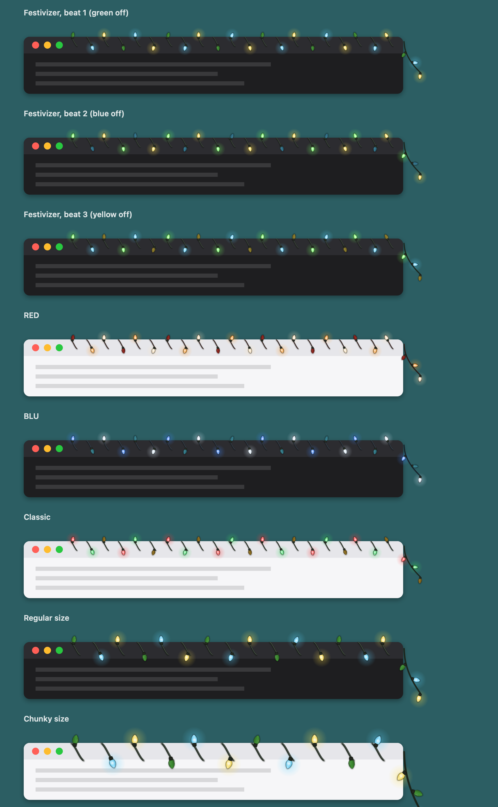

# Window Festivizer

A macOS menu-bar app that wraps the top of every window in a string of festive lights. The lights
blink the way TF2's Festivizer does: three colours, two lit at a time, with the dark one moving
along every beat. A short tail of lights hangs off each window's corner and swings when you drag it.



Inspired by Team Fortress 2's Festivizer, and by [Window Scarves](https://github.com/fiof25/window-scarves)
by fiof25 (itself inspired by Sara Gordić's Window Sweaters). Window Festivizer is written from scratch
and shares no code with either; it borrows Window Scarves' approach of tracking windows with the public
window list and drawing in see-through overlay windows. Not affiliated with or endorsed by Valve.

## Build and run

Needs macOS 14 or later and Xcode.

1. Open `WindowFestivizer.xcodeproj`.
2. Pick the **WindowFestivizer** scheme and **My Mac**, then press **Cmd-R**.
3. Look for the sparkles icon in the menu bar. There is no Dock icon and no window.

It needs no permissions (no Accessibility, no Screen Recording). The project signs with
"Sign to Run Locally", so it builds without an Apple developer account. To share a build, pick your
team under the target's **Signing & Capabilities** tab.

## The menu

- **Lights On / Off**
- **Lights**: Festivizer (green, blue, yellow), RED, BLU, Classic, or Mixed (a different set per app)
- **Size**: Slim, Regular or Chunky
- **Pattern**: Festivizer (two of three colours lit) or Steady
- **Swinging Tail**: the string hanging off each window's right corner

Full-screen windows, popovers, sheets and small dialogs go without lights. The wrap starts just right of
the red, yellow and green buttons so they stay visible, and clicks always pass through the lights.

## How it works

| File | What it does |
| --- | --- |
| `App/WindowFestivizerApp.swift` | Entry point. Starts the menu-bar app, or handles `--render`. |
| `App/AppDelegate.swift` | The menu-bar icon and its menu. |
| `App/Settings.swift` | Menu choices, saved in UserDefaults. Wrap sizes are defined here. |
| `Windows/WindowTracker.swift` | Reads the window list about 7 times a second (60 while something moves), decides which windows get lights, keeps the lights stacked above them, and ticks the blink beat. |
| `Windows/LightsOverlay.swift` | One window's lights: a wrap overlay along the top and a tail overlay at the corner. |
| `Windows/OverlayWindow.swift` | The see-through, click-through window the lights are drawn in. |
| `Lights/WrapGeometry.swift` | The maths. The title bar is treated as a pole and the wire as a helix around it; only the front half of each turn is drawn. |
| `Lights/BulbArt.swift` | Draws the bulbs, glow and wire with Core Graphics. There are no image files. |
| `Lights/LightLayers.swift` | Turns the art into Core Animation layers, grouped by colour so a blink is a few opacity changes. |
| `Lights/FestivizerPattern.swift` | The blink rule: on beat *n*, colour *n mod 3* is dark. |
| `Lights/SwingingTail.swift` | Verlet rope physics for the tail. Only runs while the tail is moving. |
| `Lights/Theme.swift` | The colour sets. |
| `Dev/PreviewRenderer.swift` | The `--render` developer option below. |

Measured on an M1 with 9 windows decorated: about 2% of one CPU core while idle, most of it spent
waiting on the WindowServer for the window list, and about 65 MB of memory.

## Developer options

Save a picture of the lights on pretend windows (the image above), without touching your real windows:

```sh
xcodebuild -project WindowFestivizer.xcodeproj -scheme WindowFestivizer -configuration Release -derivedDataPath build/DerivedData build
build/DerivedData/Build/Products/Release/WindowFestivizer.app/Contents/MacOS/WindowFestivizer --render docs/preview.png
```

Log when and why the tracker speeds up: set the environment variable `FESTIVIZER_LOG=1`
(in Xcode: Product > Scheme > Edit Scheme > Run > Arguments > Environment Variables).

Clear saved settings: `defaults delete com.aayanrahman.windowfestivizer`

## Known issues

- Clicking a window that's behind others can briefly cover its lights until they're re-stacked a
  frame later. Window Scarves avoids this by lifting the overlay just above normal windows while
  the pointer is over it.
- During Show Desktop and Mission Control, the lights catch up with the windows a moment late.

## Roadmap

- Choose which apps get lights, and a front-window-only mode
- Unboxing: open a crate from the menu to unlock new light sets, with a reveal animation
- Sounds for unboxing and for switching the lights on
- App icon and a downloadable release build
